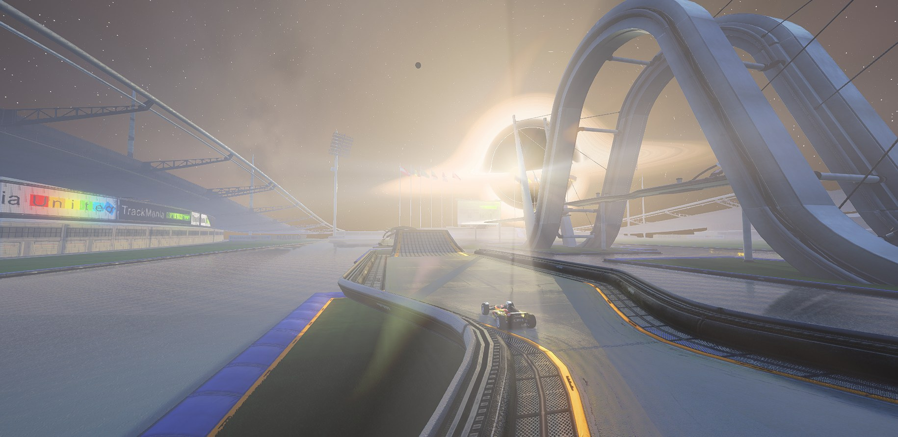
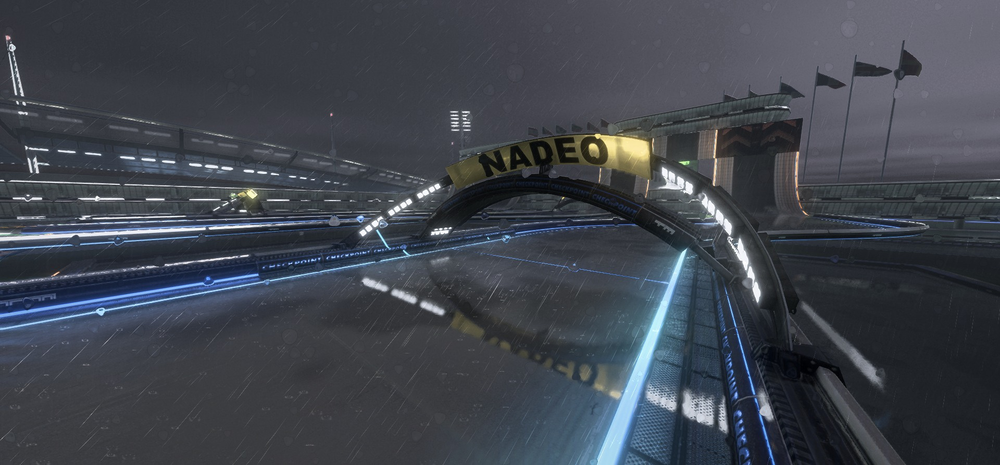
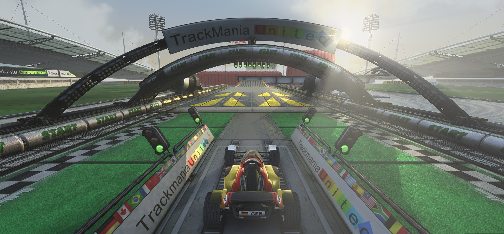
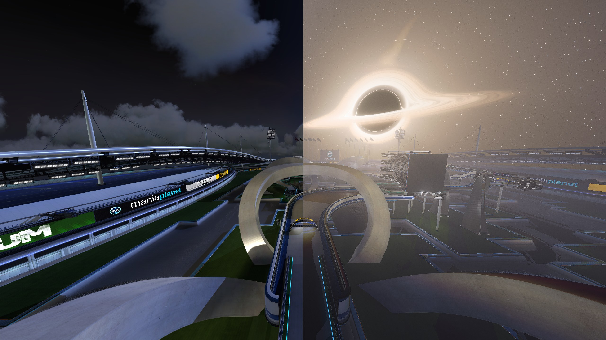
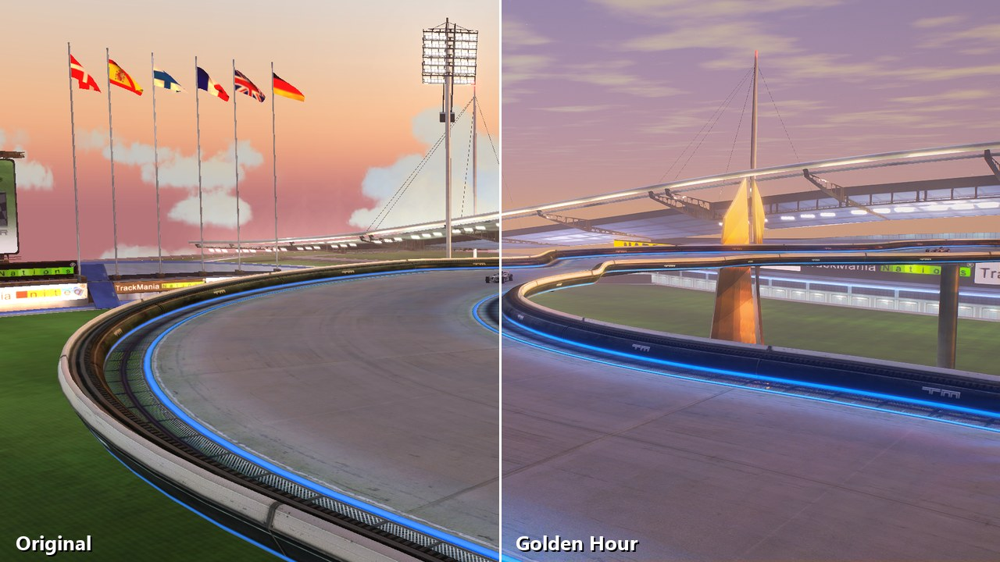
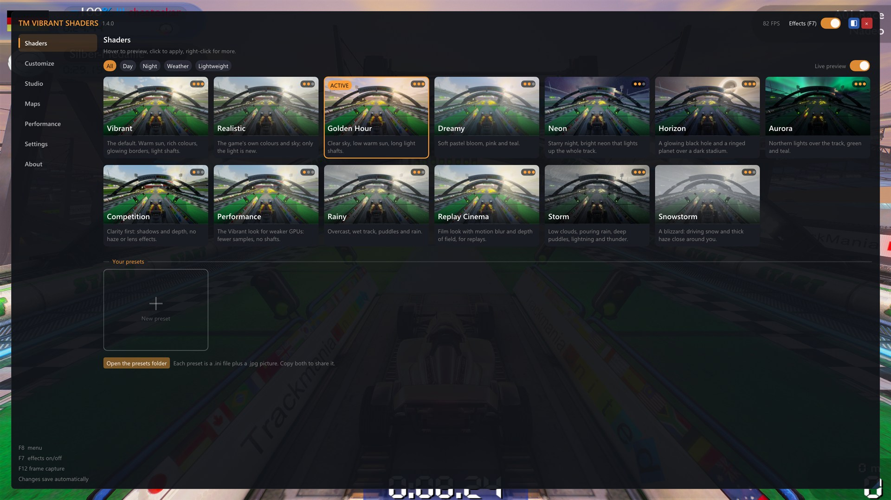

# TM Vibrant Shaders

**Real-time lighting, weather and skies for TrackMania Nations Forever, United Forever and TrackMania 2 (ManiaPlanet).**

[](https://github.com/cheatoskar/TM-Vibrant-Shaders/releases/latest)
[](https://github.com/cheatoskar/TM-Vibrant-Shaders/actions/workflows/build.yml)


[](LICENSE)







A mod for Direct3D 9 (TrackMania Nations / United Forever) and Direct3D 11 (TrackMania 2, ManiaPlanet 4) that lights the game again: shadows, ambient occlusion, light shafts, bounce light, glowing neon, rain with sound and lightning, snow, wet roads with reflections, water, volumetric clouds and new skies. It draws inside the game's renderer, before the HUD, so the interface stays sharp. It works while driving, in replays and in the video export.

**[Download the latest release](https://github.com/cheatoskar/TM-Vibrant-Shaders/releases/latest)** · [Install](#install) · [Features](#features) · [Presets](#presets) · [Share a look](#your-own-presets-and-sharing-them) · [Author's Shader](#authors-shader) · [Controls](#controls) · [Known issues](#known-issues) · [Documentation](#documentation)

**New in 1.4.1: TrackMania 2 (ManiaPlanet 4).** The same mod for ManiaPlanet's Direct3D 11 renderer: download `TM-Vibrant-Shaders.zip` from the [release](https://github.com/cheatoskar/TM-Vibrant-Shaders/releases) (one zip for both games), close the game, run `TM-Vibrant-Shaders-Setup.exe`. `F8` menu, `F5` on/off. Details in [maniaplanet/README.md](maniaplanet/README.md).



---

## Install

**Full installation guide: [docs/install.md](docs/install.md)**: ModLoader, setup, by hand, updating, uninstalling.

### With the ModLoader: installs and updates itself

If you start TrackMania Nations/United Forever through the [ModLoader (TMLoader)](https://tomashu.dev/software/tmloader/), let it install the mod and every update:

1. Close the ModLoader. Open `%LOCALAPPDATA%\TMLoader\config.yaml` with Notepad (paste the path into the Explorer address bar).
2. Add this line under `servers:` (two spaces in front, like the lines there) and save:

   ```yaml
     - 'https://cheatoskar.github.io/TM-Vibrant-Shaders/modloader/'
   ```

3. Start the ModLoader, tick *TM Vibrant Shaders* in your profile and start the game.

New versions then come through the ModLoader's auto update; nothing to download. For pre-releases use `https://cheatoskar.github.io/TM-Vibrant-Shaders/modloader/beta/` instead (one of the two, not both). TrackMania 2 has no ModLoader: use the setup.

### With the setup

1. Download **`TM-Vibrant-Shaders.zip`** from the [latest release](https://github.com/cheatoskar/TM-Vibrant-Shaders/releases/latest) and extract the whole zip.
2. Close TrackMania and run **`TM-Vibrant-Shaders-Setup.exe`**.
3. Choose where to install:

   | Button | When to pick it |
   |---|---|
   | **Install for the TrackMania ModLoader** | You use the [ModLoader (TMLoader)](https://tomashu.dev/software/tmloader/). Afterwards tick *TM Vibrant Shaders* in your ModLoader profile. |
   | **Install into TrackMania Nations Forever** / **United Forever** | No ModLoader. The setup lists every TrackMania it finds, each with its own button, and puts a `d3d9.dll` next to `TmForever.exe`. |
   | **Install into TrackMania 2 (ManiaPlanet)** | The setup puts a 64-bit `d3d11.dll` next to `ManiaPlanet.exe`. Details: [maniaplanet/README.md](maniaplanet/README.md). |
   | **Install into another game folder** | Your game isn't in the list. Pick the folder that contains `TmForever.exe` or `ManiaPlanet.exe`. |

4. Start the game. Press **`F8`** for the menu.

By hand, TrackMania 2 needs only the `d3d11.dll` from the zip, copied next to `ManiaPlanet.exe` (start ManiaPlanet 64-bit). Run the setup again to update or uninstall; your settings stay. Windows SmartScreen may warn because the setup isn't code-signed: *More info → Run anyway*, or install by hand. Manual install, updating and the recommended game settings: **[docs/install.md](docs/install.md)**. Deutsche Anleitung: **[docs/INSTALL_DE.md](docs/INSTALL_DE.md)**.

---

## Features

| | |
|---|---|
| **Light and shadow** | Ambient occlusion. Sun shadows, plus long-range shadows from a height map of the track that builds up while you drive, so a low sun casts long shadows from objects off screen too. Light shafts, volumetric light with shadows in the haze, bounce light (one bounce of coloured light), neon borders that light up the road around them. |
| **Weather** | Rain as particles that streak with the camera, splashes, ripples, streams down walls, drops on the lens. Wet roads and puddles with reflections. Thunderstorms with lightning bolts and flashes. Spray behind the car. |
| **Snow** | Falling snow up to a blizzard, flakes on the lens, snow on the ground in piles and drifts or as a closed blanket, sparkling in the sun. Your car keeps its paint and throws up powder snow. A wind sound for the storm. |
| **Sound** | Rain and thunder from real recordings, wind in a snow storm: a rain loop that follows the rain amount and ten different thunders, from close cracks to far rumbles. Each strike sounds a little different and comes from the side of the flash. |
| **Water** | Pools, rivers and the TMUF seas get waves, refraction and reflections, with the stands and ramps around a pool mirrored in it. The mod knows water by the game's own water surface, so dirt, grass or roads at the same height stay what they are. |
| **Sky** | Volumetric clouds. Clear sky, starry night with shooting stars, aurora, a black hole that bends light and lights the scene, and the Ring World: Saturn, Jupiter, an ice giant or an exotic planet, seen from far away, next to the rings or right above them. Night skies work on day maps. |
| **Camera** | HDR bloom, auto exposure, filmic tone curve, colour looks from `.cube` LUT files. SMAA or FXAA, temporal anti-aliasing, AMD CAS sharpening, a render scale with AMD FSR 1 upscaling. Motion blur and depth of field that switch on by themselves in replays and the video export. |
| **Extras** | A neon light trail behind your car for the whole run. Track reflections up to a mirror finish. Grass detail and mowing stripes. |
| **Comfort** | `F8` menu with a gallery of every preset: a picture of each, its GPU load, and a live preview in the game while you point at it. *Customize* for the main settings, *Studio* for every setting in panels side by side, with a search box and a reset arrow for every changed setting. The menu tells you when a new version is out (one request to GitHub per game start, can be switched off). Auto quality holds your frame rate. A live per-effect cost panel. A preset per map mood (day, sunset, night). Your own presets as files, or any look as one line of text to paste into a chat (*Copy share code*). Map authors can ship a look inside their map ([Author's Shader](#authors-shader)). |



---

## Presets

| Preset | Look |
|---|---|
| **Vibrant** | The default. Warm sun, rich colours, glowing borders, light shafts. |
| **Realistic** | TrackMania's own colours and sky. Only the light is new: shadows, ambient occlusion, bounce light, a little haze. |
| **Golden Hour** | Clear sky, low warm sun, long light shafts. |
| **Dreamy** | Soft pastel bloom, pink and teal. |
| **Neon** | Starry night, bright neon that lights up the whole track. |
| **Horizon** | A glowing black hole and a ringed planet over a dark stadium; the black hole lights the scene. |
| **Aurora** | Northern lights, green and teal. |
| **Rainy** | Overcast, wet track, puddles, rain. |
| **Storm** | Low clouds, pouring rain, deep puddles, lightning and thunder. |
| **Snowstorm** | A blizzard: driving snow, thick haze close around you and the howl of the wind. Snow on the ground is off (*Snow on the ground* in the menu; a snow texture pack looks better on the road). |
| **Replay Cinema** | Film look with motion blur and depth of field, for replays and the video export. |
| **Competition** | Clarity first: AO and contact shadows, no haze or lens effects. |
| **Performance** | Vibrant with the expensive parts off. |

By default the mod picks **Vibrant** on day maps, **Golden Hour** on sunset maps and **Horizon** on night maps. Change it on the *Maps* page of the menu, or right-click a preset. Every sky works with every preset.

### Your own presets and sharing them

**Make one:** start from the preset closest to what you want and change it in *Customize* or *Studio* (it shows as *Custom* now). Then click the **+** card under *Your presets* and give it a name. The game behind the menu becomes its picture. Right-click your card to edit the description, update the picture or delete it.

**Share it:**

- **As text:** on the *Shaders* page, **Copy share code** puts the look on the clipboard as one line starting with `TMVS1:`. Post it in Discord or wherever. The other person copies the message and presses **Paste share code**; the look is then active as *Custom*, and the **+** card saves it. The code works between Nations/United and TrackMania 2.
- **As files:** a preset is `<Name>.ini` plus `<Name>.jpg` in `Documents\TrackMania\TMVS\presets\` (**Open the presets folder** in the menu takes you there). Send both files; dropped into the same folder, they show up in the list straight away.
- **In a map:** the look travels with the map, see [Author's Shader](#authors-shader).

Settings that belong to your PC (render scale, auto quality, TAA jitter, video export, hotkeys) are never part of a shared look; everyone keeps their own. More in [docs/settings.md](docs/settings.md#share-a-preset-as-text).

---

## Author's Shader

A map can bring its own look. When a map author stores a look in the map, everyone with the mod sees the map exactly that way. On the next map without one, your own look is back. Your `settings.ini` is never changed.

**As a player** there is nothing to do: the look loads with the map, takes priority over your preset per map mood, and the menu shows *Author's Shader* as the preset. Change any value and it becomes *Custom*; *Reset preset* brings the author's look back. To always keep your own look, switch off *Author's Shaders* (*Settings* page).

**As a map author:**

1. Open your map in the map editor.
2. Build the look you want with the `F8` menu: start from a preset and change values.
3. On the *Maps* page, under *Author's Shader*, press **Set as Author's Shader**.
4. Save the map. The look is now part of the map file and goes wherever the map goes.

The look is stored in the map's comments as a short code, `[TMVS:` followed by a few letters and digits per changed setting and `]`. Whatever else you wrote in the comments stays; pressing the button again replaces only the old code. *Copy code* puts the code on the clipboard, so you can also paste it into the comments yourself.

You can also write a readable line by hand into the comments, with the preset and the [setting keys](docs/settings.md#all-settings):

```
[TMVS] Preset=Snowstorm Snow=1.5 SnowCover=0.8 SkyMode=3
```

Preset names with spaces take an underscore (`Golden_Hour`). Machine settings (auto quality, target FPS, sound volume, the neon trail, *Cinematic in replays only*, TAA jitter, the MSAA and depth options) are never taken from a map.

---

## Controls

Default keys; every one can be changed in the menu (*Settings* → *Hotkeys*, [details](docs/settings.md#hotkeys)).

| Key | Action |
|---|---|
| `F8` | Open or close the menu (`F5` when CenterSpeed is loaded) |
| `F7` | Shaders on or off, for a before/after look |
| `F12` | Save a screenshot and a frame capture (attach both to bug reports) |
| `Ctrl+F9` | Reload the shaders (development). Not `F9`: that opens the menu of the 100% TMX mod. Hotkeys only react while the game window is in front |
| `F11` | Trace the next frame (development) |
| `F6` | [Photo mode](docs/settings.md#photo-mode) on or off (on by itself with the free camera, cam 7): no HUD, full quality. `F12` saves a photo without the HUD, `Shift+F12` a larger one, middle click sets the focus, `Shift`+wheel zooms, `Shift+F6` splits the screen: the game without and with the mod |



Settings, presets and the log live in `Documents\TrackMania\TMVS\`. Everything is saved automatically.

---

## Performance

- **Runs on:** any GPU with Shader Model 3.0, from Intel UHD 620 and GTX 750 upwards. Pick *Performance* and *Effect quality: Low* on weak GPUs.
- **Comfortable at 1080p:** GTX 1060, RX 580, Radeon 780M, Intel Arc 140V.
- **Everything on at 1440p:** RTX 3060, GTX 1080 Ti and faster.

**Auto quality** is on by default. When your frame rate drops below the target it turns off the effects that cost the most on your GPU, only as many as it has to, and brings them back when there is room. Your settings stay as they are. On a weak GPU, *Render scale (FSR)* at 0.77 or 0.67 is another way to more FPS. The *Performance* section in the menu shows what each effect costs on your GPU, live. Measured numbers and the most expensive settings: **[docs/performance.md](docs/performance.md)**.

---

## Compatibility

| | |
|---|---|
| TrackMania Nations Forever | Yes |
| TrackMania United Forever | Yes (the mod detects the game build and the map's environment) |
| TrackMania 2 (ManiaPlanet 4) | Yes, as `d3d11.dll` ([maniaplanet/README.md](maniaplanet/README.md)) |
| TrackMania Nations ESWC, Trackmania (2020) | No |
| TrackMania ModLoader (TMLoader) | Yes, or without it as `d3d9.dll` |
| CenterSpeed (speedometer) | Yes. With both loaded, this mod's menu opens with `F5` (CenterSpeed uses `F8`) |
| Other `d3d9.dll` mods (ReShade and similar) | Not as `d3d9.dll` in the same game folder. Together with the ModLoader install: untested |
| Windows | 10 and 11 |

## Known issues

- **Snow on the ground** (*Snow on the ground*, off in every preset) doesn't follow the game's textures and surfaces well (it can lie across markings, kerbs and edges). For snowy roads a snow texture pack looks better.
- **Headlights on very bright blocks** (United Forever Island at night): the game itself draws the light pool pure white, so there is no texture left under it.
- **Floodlit stadiums at night** keep part of the game's burned-out white (*Floodlit surfaces* sets how much).
- **Shaders off with the game's FX post-processing** was reported once (TMNF, shadows *High*). *Turn off game FX* (on by default) should prevent it; if not, switch FX off in the launcher.
- **Bloom costs ~3 ms on integrated GPUs**; *Performance* preset or auto quality help.
- If something flickers or looks wrong, press `F12` there and attach the screenshot and the capture to an [issue](https://github.com/cheatoskar/TM-Vibrant-Shaders/issues).

---

## Documentation

| Page | Contents |
|---|---|
| [Installation](docs/install.md) | Setup, manual install, ModLoader or game folder, updating, uninstalling, recommended game settings |
| [Settings](docs/settings.md) | Every setting in the menu, mood presets, your own presets |
| [Performance](docs/performance.md) | Hardware, measured costs, what to turn off for more FPS |
| [Troubleshooting](docs/troubleshooting.md) | No effects, no sound, low FPS, HUD problems, how to report a bug |
| [How it works](docs/how-it-works.md) | Hooks, depth buffer, the render passes, the two game builds |
| [Building](docs/building.md) | Build from source, the offline previewer, project layout |
| [Installation (Deutsch)](docs/INSTALL_DE.md) | Installation und Bedienung auf Deutsch |
| [Changelog](CHANGELOG.md) | What changed in each version |

---

## Development Note

This mod was developed with the help of [Claude Code](https://claude.com/claude-code). The ideas, presets, design and testing are my own, with AI assisting throughout the development process. If you find a bug, please report it in the [issues](https://github.com/cheatoskar/TM-Vibrant-Shaders/issues).

---

## Credits

- [Dear ImGui](https://github.com/ocornut/imgui) (MIT) for the menu, [minimp3](https://github.com/lieff/minimp3) (CC0) for the sound. See [THIRD_PARTY_NOTICES.md](THIRD_PARTY_NOTICES.md).
- Rain and thunder recordings from [freesound.org](https://freesound.org) (CC0) by Rubaoliva, loganzsound, seth-m, Fission9, TRP, Kinoton, Martineerok, kingsrow and bastipictures. See [sounds/CREDITS.md](sounds/CREDITS.md).
- Anti-aliasing and sharpening: SMAA (Jorge Jimenez, Jose I. Echevarria, Belen Masia, Fernando Navarro, Diego Gutierrez; the reference shader and its area and search textures), FXAA 3.11 (Timothy Lottes) and AMD FidelityFX CAS; the render scale's upscaling is AMD FidelityFX FSR 1. The look is inspired by the Minecraft shader packs Sildur's Vibrant, BSL and IterationT; no code from them is used.
- TrackMania is a trademark of Ubisoft / Nadeo. This is a fan project and has nothing to do with them.

## License

© 2026 Oskar (cheatoskar). [MIT License](LICENSE). Third-party parts keep their own licenses ([THIRD_PARTY_NOTICES.md](THIRD_PARTY_NOTICES.md)).
