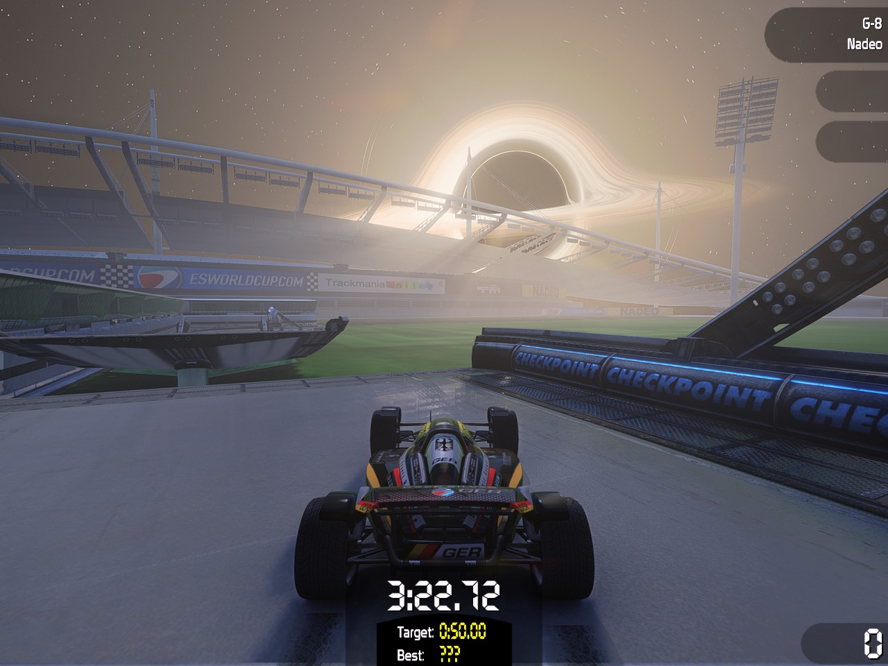

# Installation

[Back to the README](../README.md) · [Deutsch](INSTALL_DE.md)

## What you need

- TrackMania Nations Forever or TrackMania United Forever, or TrackMania 2 (ManiaPlanet 4, 64-bit, see [TrackMania 2](#trackmania-2-maniaplanet-4)), on Windows 10 or 11.
- A GPU with Shader Model 3.0 (practically every GPU since 2008).
- Optional: the [TrackMania ModLoader (TMLoader)](https://tomashu.dev/software/tmloader/).

## ModLoader or game folder?

There are two ways to load the mod. Use one of them, not both.

| | ModLoader | Game folder (`d3d9.dll`) |
|---|---|---|
| How it loads | The ModLoader injects the mod when it starts the game | Windows loads `d3d9.dll` from the game folder; the mod passes every Direct3D call on to the real one |
| Switch it off | Untick it in the ModLoader profile | `F7` in game, or uninstall |
| Other mods | Combines with other ModLoader mods, CenterSpeed included (the menu moves to `F5` then) | Can't share the folder with another `d3d9.dll` (ReShade and similar) |
| Start the game | Through the ModLoader | As usual, launcher or desktop shortcut |
| Good for | People who already use the ModLoader | Everyone else |

## With the ModLoader's update server

For ModLoader users the simplest way: the ModLoader downloads the mod itself and installs every new version with its auto update.

1. Close the ModLoader.
2. Open `%LOCALAPPDATA%\TMLoader\config.yaml` with Notepad (paste the path into the Explorer address bar).
3. Add the server under `servers:`, indented like the other lines, and save:

   ```yaml
   servers:
     - 'https://modloader.tomashu.dev/modloader/TmForever/v1/'
     # ... the servers that are already there ...
     - 'https://cheatoskar.github.io/TM-Vibrant-Shaders/modloader/'
   ```

4. Start the ModLoader. *TM Vibrant Shaders* appears with its versions; tick it in your profile and start the game.

**Pre-releases:** `https://cheatoskar.github.io/TM-Vibrant-Shaders/modloader/beta/` lists the stable versions and the pre-releases. Add one of the two URLs, not both.

A copy installed earlier with the setup lives in the same place (`products\TM Vibrant Shaders\<version>`); the ModLoader keeps it and adds newer versions next to it. Old versions can be removed in the ModLoader. The in-game *About* page says whether the ModLoader updates the mod by itself.

## With the setup

1. Download **`TM-Vibrant-Shaders.zip`** from the [latest release](https://github.com/cheatoskar/TM-Vibrant-Shaders/releases/latest).
2. Extract the whole zip (right-click, *Extract All*). The setup needs the `TM Vibrant Shaders` folder next to it.
3. Close TrackMania and run **`TM-Vibrant-Shaders-Setup.exe`**. It shows what is installed and offers:
   - **Install for the TrackMania ModLoader.** Copies the mod into `%LOCALAPPDATA%\TMLoader\database\TmForever\products\`. Then open the ModLoader, tick *TM Vibrant Shaders* in your profile and start the game. If the ModLoader isn't installed, the setup offers its download page.
   - **Install into TrackMania Nations Forever** or **Install into TrackMania United Forever.** One button per game the setup finds (it looks at the Windows uninstall entries, Steam and the usual folders). It copies the mod as `d3d9.dll` next to `TmForever.exe`. A `d3d9.dll` that was there before is kept as `d3d9.dll.tmvs-backup` and restored when you uninstall.
   - **Install into TrackMania 2 (ManiaPlanet).** Copies the 64-bit `d3d11.dll` next to `ManiaPlanet.exe` (see [TrackMania 2](#trackmania-2-maniaplanet-4)).
   - **Install into another game folder.** For a game the setup didn't find. Pick the folder that contains `TmForever.exe` or `ManiaPlanet.exe`.
   - **Uninstall.** Removes the mod from the ModLoader and from every game folder it finds.
4. Start the game and press `F8`.

If the game is in *Program Files*, Windows asks for admin rights to write the `d3d9.dll` there. The setup only asks for that one step.

### SmartScreen and checksums

The setup isn't code-signed, so Windows SmartScreen may show a warning. Click *More info*, then *Run anyway*. The setup contains no mod code of its own: it copies the files that are next to it in the zip. If you'd rather not run it, install by hand.

Every release lists SHA-256 checksums. To check a download in PowerShell:

```powershell
Get-FileHash .\TM-Vibrant-Shaders.zip -Algorithm SHA256
```

## By hand

**With the ModLoader**

1. Open `%LOCALAPPDATA%\TMLoader\database\TmForever\products\` (paste it into the Explorer address bar).
2. Copy the folder `TM Vibrant Shaders` from the zip into it. Delete an older `TM Vibrant Shaders` folder first.
3. Tick *TM Vibrant Shaders* in your ModLoader profile.

**Without the ModLoader**

1. Copy `TM Vibrant Shaders\<version>\TMVibrantShaders.dll` from the zip into your TrackMania folder, next to `TmForever.exe`.
2. Rename it to **`d3d9.dll`**.

## TrackMania 2 (ManiaPlanet 4)

The same zip carries a `d3d11.dll` for ManiaPlanet's Direct3D 11 renderer (64-bit only). The ModLoader is not involved.

- **Install:** close ManiaPlanet and run the setup, button **Install into TrackMania 2 (ManiaPlanet)**. Or by hand: copy `d3d11.dll` from the zip next to `ManiaPlanet.exe`. Start ManiaPlanet **64-bit**; a message at the top says the mod is running. If the launcher starts `ManiaPlanet32.exe`, switch it to 64-bit. A `d3d11.dll` that was there before (ReShade, another mod) is kept as `d3d11.dll.tmvs-backup` by the setup and restored on uninstall.
- **Keys:** `F8` menu, `F6` photo mode, `F12` capture, but **`F5`** turns the effects on or off: `F7` is ManiaPlanet's friends list. The keys can be changed in the menu (*Settings*, *Hotkeys*).
- **Uninstall:** run the setup again and choose *Uninstall*, or delete `d3d11.dll` from the game folder. Settings stay in `Documents\ManiaPlanet\TMVS\`.
- **Online:** the mod changes the picture. It reads the camera, the sun, the car's position and the map's comments, and writes nothing into the game's memory except the map comments in the map editor when you press *Set as Author's Shader*. Whether a server or competition allows a `d3d11.dll` mod is not confirmed: check its rules. Details and the *Soft sun shadows* note: [maniaplanet/README.md](../maniaplanet/README.md#online-openplanet).

## TrackMania Nations ESWC



Only the unofficial patch *TrackMania Nations ESWC 1.80* (2021, `TmNationsESWC.exe`, reports 0.1.7.9). The original 2006 executable is not supported.

- **Install:** close the game and run the setup, button **Install into another game folder**, and pick the folder with `TmNationsESWC.exe`. Or by hand: copy `TMVibrantShaders.dll` from the zip next to `TmNationsESWC.exe` and rename it to **`d3d9.dll`**. Other mods in the folder that use another name (a `dinput8.dll`, for example) stay as they are.
- **Keys:** the same as in Nations Forever: `F8` menu, `F7` effects on or off, `F6` photo mode, `F12` capture.
- **What works:** every look setting that works on the picture: light and shadows, sky, haze, bloom, colour, rain and snow, reflections, TAA, FXAA, sharpening, render scale, auto quality, presets per map type, photo mode and photos (with depth of field), F12 captures. From the race and your car (read from the game once a frame): neon trail, car headlights (*Horror*), spray, long mesh shadows, *Hide car* in photo mode, and on the *Misc* page the split times, the Session panel and the finish effects (compared with your best). *Clips* (from 1.6): your runs as MP4, `F3` for the last seconds ([docs/clips.md](clips.md#trackmania-nations-eswc)). Motion blur with *Cinematic in replays only* runs in replays and the replay editor, not while you drive.
- **What doesn't:** no video export settings (the game's own *Shoot video* is not hooked), no water effects (its Stadium has no water), no resource packs, no minimap, no real night or game moonlight, nothing that needs the game's materials (glass, lamps, neon by material). The menu doesn't show these. Photo mode doesn't start with the free camera and keeps the game's HUD on screen (photos never have it).
- **Files:** settings and presets are shared with Nations Forever in `Documents\TrackMania\TMVS\`. The log is `tmvs-eswc.log` there. Its first lines say whether the game was recognised (`engine: TrackMania Nations ESWC ...`).
- **Uninstall:** delete `d3d9.dll` from the game folder, or run the setup and choose *Uninstall*.

## TrackMania Sunrise and TrackMania Original

From 1.6, experimental, and only these two community builds (other builds of the same games are refused: the mod then stays off and only passes Direct3D on, the log says why):

- **TrackMania Sunrise**: the Windows 10 community repack, `TmSunrise.exe` (SHA-256 `e59dfc7e...df4fe`). It ships its own `d3d9.dll` (a small Direct3D proxy).
- **TrackMania Original**: the *Online Patch v2* by GreffMASTER, `TMORIGINAL.EXE` (SHA-256 `75e129d7...175e`). It ships dgVoodoo 2.8.2 as `d3d9.dll` (with `DDraw.dll` and `dgVoodoo.conf`), which modern Windows needs to run the game.

- **Install:** close the game and run the setup, button **Install into another game folder**, and pick the folder with `TmSunrise.exe` or `TMORIGINAL.EXE`. The game's own `d3d9.dll` stays in use: the setup renames it to **`d3d9.chain.dll`** and TM Vibrant Shaders passes every Direct3D call on to it (so dgVoodoo keeps working). By hand: rename the game's `d3d9.dll` to `d3d9.chain.dll`, then copy `TMVibrantShaders.dll` next to the exe as `d3d9.dll`. Without a `d3d9.chain.dll` the mod uses Windows' own Direct3D 9.
- **Keys:** as in Nations Forever: `F8` menu, `F7` effects on or off, `F6` photo mode, `F12` capture, `F3` clips.
- **What works:** the same as in TrackMania Nations ESWC (above): the look, photo mode, F12 captures, presets; from the race and your car the neon trail, headlights (*Horror*), spray, long mesh shadows, *Hide car* (solo races and replays), split times, the Session panel, the finish effects and the clips. The games have several environments (Sunrise: Island, Bay, Coast; Original: Alpine, Rally, Speed); the car is read the same way in all of them.
- **What doesn't:** the same gaps as ESWC (no video export settings yet, no water effects, no resource packs, no minimap, nothing that needs the game's materials or light), and no clip viewer: a replay you watch is the replay editor there, which counts as a replay for *Cinematic in replays only*.
- **Horizon:** with TM Horizon installed in the same folder (its `dinput8.dll`), TM Vibrant Shaders' menu steps aside while Horizon's menu is open, as in the other games.
- **Files:** settings and presets are shared in `Documents\TrackMania\TMVS\`. The logs are `tmvs-sunrise.log` and `tmvs-original.log` there. The first lines say what was found: `engine: TrackMania Sunrise (TmSunrise.exe, SHA-256 ... as supported)` and `d3d9: the mod creates its Direct3D 9 with d3d9.chain.dll in the game folder (...)`.
- **Uninstall:** run the setup and choose *Uninstall*: it deletes `d3d9.dll` and renames `d3d9.chain.dll` back to `d3d9.dll`. By hand: the same two steps.

## Updating

With the ModLoader's update server: nothing to do, the ModLoader installs new versions itself (*Auto Update* in its settings).

Otherwise run the setup of the new version and pick the same button as before. It replaces the old version. Your settings and presets in `Documents\TrackMania\TMVS\` stay.

## Uninstalling

Run the setup and choose *Uninstall*. Or by hand: delete the `TM Vibrant Shaders` folder from the ModLoader products, `d3d9.dll` from the game folder, or `d3d11.dll` from the ManiaPlanet folder.

Your settings stay in `Documents\TrackMania\TMVS\`. Delete that folder to remove them too.

## Recommended game settings

In TrackMania's launcher, *Advanced* options:

| Game setting | Recommended | Why |
|---|---|---|
| Antialiasing | **Off** | The mod switches it off anyway (the depth effects need a readable depth buffer) and brings its own SMAA (or FXAA) and TAA. |
| Anisotropic filtering | **16x** | Costs almost nothing and keeps the road and the thin neon strips sharp in the distance, so they still glow far away. |
| Shader quality | PC3 High | The richest base image to light. Lower works, it just starts flatter. |
| Shadows | Complex | Fine. The mod adds its own shadows on top. |
| Textures | High | |
| FX post-processing | **Off** if anything looks wrong | The game's own glow and blur can interfere with the shaders (overexposed, smeared or doubled spots). Off also keeps it from adding to the mod's bloom. |
| Water geometry, stadium water | On | |

The shaders also work with everything on low. They only need the finished image and the depth buffer.

## Files

| Path | What |
|---|---|
| `Documents\TrackMania\TMVS\settings.ini` | Your settings (saved automatically) |
| `Documents\TrackMania\TMVS\presets\*.ini` | Your own presets, one file each |
| `Documents\TrackMania\TMVS\tmvs.log` | Log of the last game start |
| `Documents\TrackMania\TMVS\capture_*.tmcap`, `screen_*.bmp` | Frame captures and screenshots from `F12` |
